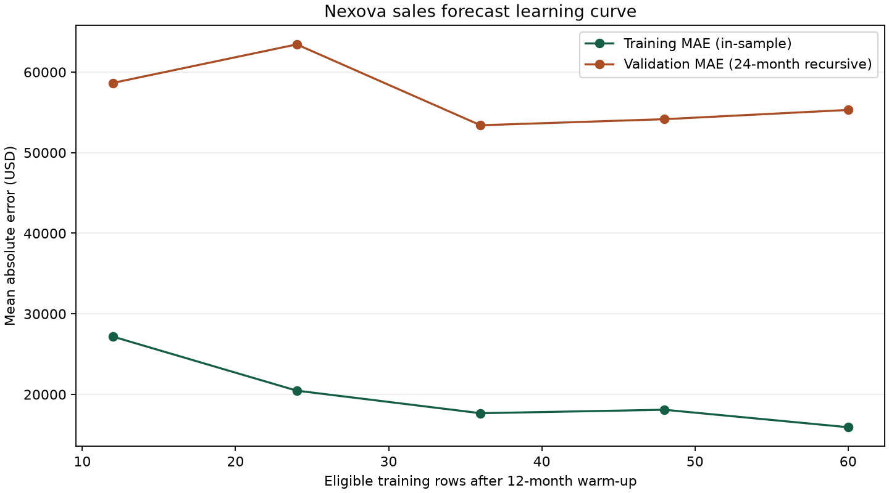

# Nexova sales forecasting evaluation

## Decision and diagnosis

**Diagnosis: overfitting pattern**, with limited confidence about the cause. The fixed-origin learning curve has a persistent, wide training-validation gap: at 60 fitted rows, training MAE is $15,930 and validation MAE is $55,301, a $39,370 gap. The training curve decreases while validation remains between $53,400 and $63,432 at the four larger sizes; the lines do not converge. Validation MAE is higher than the same-origin seasonal-naive baseline's $46,787 at every curve point. Across the five folds, the model also has higher MAE than the baseline in every fold. This is evidence against a well-fitted model relative to that comparator, not evidence that both curves converge at high error.

This classification describes the observed generalization-gap pattern, not a proven causal mechanism. Training scores are one-step, in-sample predictions using observed history, whereas validation forecasts are recursive over 24 months. Accumulated forecast error, changes in the revenue level, and the forest's inability to extrapolate beyond training targets could also contribute. The historical windows alone cannot distinguish these effects from estimator overfitting. Finance has supplied no acceptable error threshold; **business acceptance and staging approval remain undecided**.

## Data, model, and reproducibility

- Input: `data/raw/nexova_sales.csv`, SHA-256 `02e230c221a375b764d84025f282ae1309915eb218ef5e5e7450b47672a886e7`. The target is positive monthly `revenue_usd` for `business_line == "consolidated"`. Other fields are `month`, `active_contracts`, and `avg_contract_value_usd`; future contract values are not model inputs.
- Original split: 96 months, 2016-01 through 2023-12, for training and development; 24 months, 2024-01 through 2025-12, held out. The held-out period was not used for this evaluation, its diagnosis, or the recommendation. Earlier work evaluated that holdout; it must not be used repeatedly for tuning or represented as a fresh independent test.
- Existing untuned scikit-learn `RandomForestRegressor`: `n_estimators=200`, `min_samples_leaf=2`, `random_state=42`, `n_jobs=1`; remaining estimator defaults and the complete parameter set are recorded per point in `evaluation_data.json`. The median imputer and forest are fitted anew on each history's eligible rows. Features are month, sine/cosine calendar signals, 1- and 12-month revenue lags, and the preceding three-month rolling mean. The first 12 months of each history are warm-up, leaving 12-60 fitted rows for the evaluated histories.
- Environment: Python 3.14.5, NumPy 2.5.5, pandas 3.1.1, scikit-learn 1.9.1, matplotlib 3.11.2, joblib 1.6.0. From the repository root run `uv run python scripts/evaluate_sales_forecast.py` to regenerate the figure and `evaluation_data.json`, then `uv run pytest tests/pipelines/test_sales_forecast.py tests/pipelines/test_sales_forecast_evaluation.py -q`. This report records the results of that run and should be updated if inputs, code, or environment change.

## Metrics and business interpretation

MAE is the primary metric: the requester confirmed that the cost of a miss grows roughly with its size, making absolute error in USD an interpretable proxy. RMSE, also in USD, is secondary and gives greater weight to larger misses. The requester separately confirmed that overforecasting is more costly; the sales forecast context itself does not establish that preference or a directional cost ratio. MAE and RMSE both treat positive and negative errors symmetrically, so neither measures this asymmetric business cost. The table therefore also reports the mean signed error `prediction - actual`, the percentage of months with positive errors, and the mean positive error in those months. These are risk indicators, not a calculation of financial loss.

## Time-aware cross-validation

Five expanding training windows start in 2016-01. Each model forecasts the next 24 consecutive months at once. Windows overlap by 12 validation months, so folds are not independent; their standard deviation is descriptive, not a confidence interval. There is no shuffle. Each fold fits features and preprocessing on its own training history; validation starts with that history and subsequent lag/rolling values use prior predictions, not validation actuals. The seasonal-naive comparator repeats the last 12 actual training months for both validation years. Scores below are USD except percentages; training scores are in-sample.

| Training end | Fitted rows | Validation period  | Train MAE | Train RMSE | Validation MAE | Validation RMSE | Baseline MAE | Baseline RMSE | Mean signed error | Overforecast months | Mean overforecast |
| ------------ | ----------: | ------------------ | --------: | ---------: | -------------: | --------------: | -----------: | ------------: | ----------------: | ------------------: | ----------------: |
| 2017-12      |          12 | 2018-01 to 2019-12 |    27,738 |     41,932 |         51,345 |          62,209 |       35,245 |        45,040 |           -23,671 |        29.2% (7/24) |            47,442 |
| 2018-12      |          24 | 2019-01 to 2020-12 |    14,578 |     21,473 |         63,620 |          70,025 |       54,926 |        62,980 |           -51,861 |         8.3% (2/24) |            70,558 |
| 2019-12      |          36 | 2020-01 to 2021-12 |    14,936 |     19,271 |         53,515 |          61,302 |       51,557 |        60,802 |           -39,509 |        20.8% (5/24) |            33,615 |
| 2020-12      |          48 | 2021-01 to 2022-12 |    13,721 |     17,061 |         66,383 |          70,973 |       59,750 |        67,070 |           -66,383 |         0.0% (0/24) |       Not defined |
| 2021-12      |          60 | 2022-01 to 2023-12 |    15,930 |     20,136 |         55,301 |          68,080 |       46,787 |        60,151 |           -18,877 |        37.5% (9/24) |            48,565 |

Across folds, validation **MAE = $58,032.90 ± $5,891.46** and **RMSE = $66,517.95 ± $4,008.94**, using unweighted means and population standard deviations (`ddof=0`). The corresponding mean baseline MAE is $49,652.96 and RMSE is $59,208.49. Fold MAE ranges from $51,345 to $66,383, so performance varies by origin even though the windows overlap. RMSE exceeds MAE in every fold, consistent with some larger errors having extra influence, but neither establishes their business cost. Negative mean signed errors in all five folds indicate net underforecasting; this does not remove the need to examine the costly overforecasting cases separately.

## Learning curve

All points forecast 2022-01 through 2023-12 from the 2021-12 origin. Each training set is the most recent number of months shown, with no older observations used to fill its lag features. Changes in included historical periods as well as sample size may affect the curve. Each validation window contains 24 months; each row is fitted independently.

| History months | History start | Eligible fitted rows | Train MAE (USD) | Train RMSE (USD) | Validation MAE (USD) | Validation RMSE (USD) |
| -------------: | ------------- | -------------------: | --------------: | ---------------: | -------------------: | --------------------: |
|             24 | 2020-01       |                   12 |          27,173 |           38,862 |               58,653 |                71,488 |
|             36 | 2019-01       |                   24 |          20,467 |           29,538 |               63,432 |                76,082 |
|             48 | 2018-01       |                   36 |          17,669 |           22,961 |               53,400 |                67,182 |
|             60 | 2017-01       |                   48 |          18,098 |           21,664 |               54,152 |                68,355 |
|             72 | 2016-01       |                   60 |          15,930 |           20,136 |               55,301 |                68,080 |

## Recommended next action

Run a **train-only regularization experiment** with `min_samples_leaf=4` and `min_samples_leaf=8`, keeping the existing 200 trees, seed, features, 24-month recursive protocol, and all other settings unchanged. Compare each candidate against the current `min_samples_leaf=2` model and the seasonal-naive baseline on the same five chronological folds. Report per-fold and mean MAE/RMSE, the train-validation gap, and overforecast frequency and mean positive error; prefer a candidate only if its validation evidence actually improves, rather than assuming regularization fixes the issue. This directly tests whether less complex leaf fits reduce the observed gap while preserving forecasting accuracy. If neither candidate improves, investigate recursive horizon errors and the forest's growth-extrapolation limitation before claiming complexity is the cause. Use no 2024-2025 outcomes for candidate selection; obtain Finance's acceptable error and directional costs and a genuinely new later evaluation period before a promotion decision.

The dataset ends in 2025 and contains only consolidated rows, so it cannot establish current forecast performance or business-line mix effects. The five overlapping folds, small sample sizes, changing history regimes, 24-month recursive horizon, and in-sample training scores limit both stability and causal conclusions.
